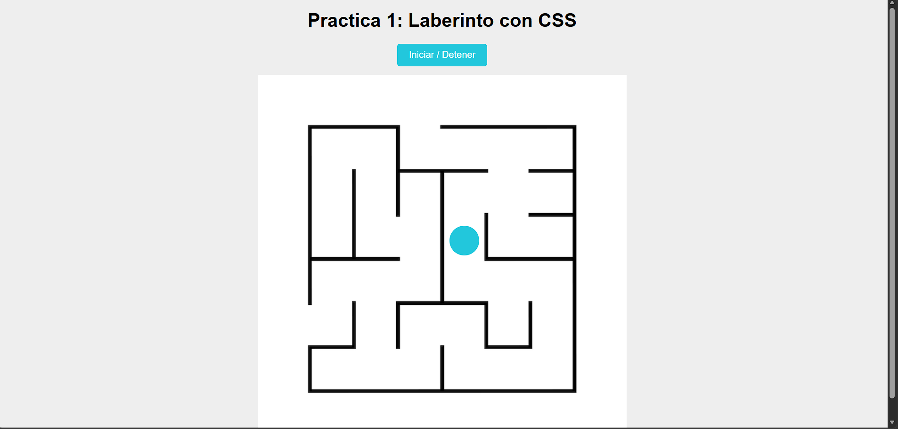

# Laberinto animado con CSS

Al presionar un botón, una figura recorre el laberinto sola: se convierte en círculo para caber en los pasillos y sale como una estrella que gira y cambia de color. Hecho para la materia de Aplicaciones Web en la Universidad Politécnica de Sinaloa.

## Cómo funciona
- **Sin JavaScript:** el botón es un `checkbox` oculto, y la animación arranca con el selector `:checked`.
- El recorrido está hecho con `@keyframes`, y la estrella con `clip-path`.

## Tecnologías
HTML · CSS

## Ver en línea
https://laberinto-eduardocruz.netlify.app